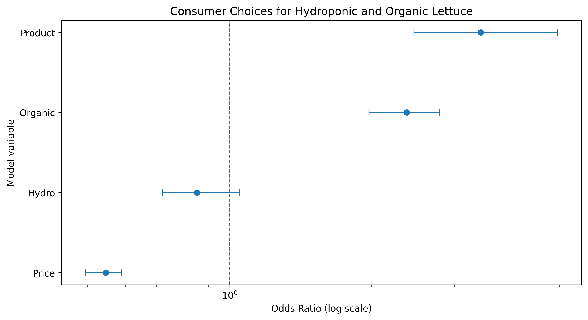

# Consumer Choices for Hydroponic and Organic Lettuce: A Discrete-Choice Analysis


**Research areas:** Agricultural Economics · Consumer Behaviour · Food Marketing · Sustainable Agriculture · Applied Econometrics

**Project type:** Quantitative consumer-choice research

**Primary method:** Conditional logistic regression

**Programming environment:** Python, Jupyter Notebook, and Google Colab

---

## 1. Project Overview

Consumer preferences play an important role in the marketing of agricultural products and the development of alternative food production systems. Understanding how consumers evaluate production methods, product attributes, and prices can help researchers investigate food purchasing decisions and the potential market positioning of differentiated agricultural products.

This project examines stated consumer choices for lettuce using a discrete-choice dataset containing information about hydroponic production, organic status, and price.

The analysis investigates how these attributes are associated with the relative likelihood that a lettuce alternative is selected within a choice set. It also considers the availability of a no-purchase option, allowing the analysis to distinguish product selection from the decision not to purchase.

The cleaned analytical dataset contains 4,752 alternative-level observations from 198 participants and 1,584 choice sets. Each choice set contains three alternatives, with one recorded selection.

Using Python, pandas, and conditional logistic regression, the project demonstrates a reproducible workflow for agricultural consumer research, including data preparation, exploratory analysis, statistical modelling, odds-ratio interpretation, visualization, and scientific communication.

The emphasis is on understanding the evidence supported by the observed stated choices while accounting for statistical uncertainty and the limitations of the available data.

## 2. Research Motivation

Agricultural markets increasingly feature products differentiated by production method, certification, sustainability characteristics, and price.

Hydroponic production and organic status represent different product attributes that may influence how consumers evaluate lettuce. However, their market implications cannot be established simply by assuming that consumers prefer one production system over another.

Price is also an important consideration because consumers evaluate product characteristics alongside their financial cost.

A discrete-choice framework provides a structured way to investigate these preferences by examining the attributes of alternatives selected within the same choice set.

This project applies that framework to explore three principal attributes:

- **Hydroponic production:** Whether the lettuce alternative is identified as hydroponically produced.
- **Organic status:** Whether the alternative carries the organic attribute.
- **Price:** The stated price associated with each alternative.

The analysis contributes to agricultural economics by demonstrating how consumer stated-choice data can be prepared, modelled, interpreted, and communicated using quantitative methods.

## 3. Research Aim and Objectives

### Research aim

To examine how hydroponic production, organic status, and price are associated with consumer stated choices for lettuce using conditional logistic regression.

### Specific objectives

1. Prepare and validate a structured consumer-choice dataset.
2. Describe the distribution of participants, choice sets, alternatives, attributes, and observed selections.
3. Estimate the associations between product attributes and alternative selection.
4. Examine the relationship between price and the relative likelihood of selection.
5. Interpret model coefficients using odds ratios and confidence intervals.
6. Visualize the estimated relationships and their statistical uncertainty.
7. Assess the limitations of the model and the generalizability of the findings.
8. Document the analytical workflow to support reproducibility and independent review.

## 4. Research Questions

The analysis addresses the following questions:

**RQ1.** How is hydroponic production associated with the relative likelihood of selecting a lettuce alternative?

**RQ2.** How is organic status associated with consumer stated choice?

**RQ3.** How is price associated with the relative likelihood that an alternative is selected?

**RQ4.** How does product selection relate to the availability of a no-purchase alternative?

**RQ5.** How precise are the estimated relationships, and what methodological limitations affect their interpretation?

These questions concern associations within the analysed stated-choice dataset. The results should not automatically be interpreted as causal effects or direct predictions of actual retail purchasing behaviour.

## 5. Dataset and Study Design

The project uses a lettuce consumer-choice dataset originally identified as `AE_hydro_org.csv`.

The cleaned analytical dataset is named `lettuce_consumer_choice_clean.csv`.

### Dataset summary

| Characteristic | Value |
|---|---:|
| Alternative-level observations | 4,752 |
| Variables in the cleaned dataset | 7 |
| Participants | 198 |
| Choice sets | 1,584 |
| Alternatives per choice set | 3 |
| Recorded selections per choice set | 1 |
| Main modelling approach | Conditional logistic regression |

The dataset is organized at the alternative level. Each participant evaluates multiple choice sets, and each choice set contains three alternatives.

One alternative is recorded as selected within each choice set.

Consequently, the observations are grouped rather than fully independent: alternatives belong to choice sets, and multiple choice sets may belong to the same participant.

This structure is central to the selection of an appropriate statistical model and the interpretation of uncertainty.

### Variables

| Variable | Description | Analytical role |
|---|---|---|
| `ID` | Participant identifier | Identifies participants |
| `cset` | Choice-set identifier | Identifies alternatives presented within a choice set |
| `Alternative` | Alternative identifier | Distinguishes alternatives |
| `Choice` | Selection indicator | Identifies the selected alternative |
| `Hydro` | Hydroponic attribute indicator | Represents hydroponic production status |
| `Organic` | Organic attribute indicator | Represents organic status |
| `Price` | Alternative price | Represents the stated price |

The exact coding of the attributes and the units of price should be confirmed against the original dataset documentation or questionnaire before interpreting the model estimates substantively.

### The no-purchase alternative

The prepared dataset identifies Alternative 3 as the no-purchase option. Its recorded attribute values are:

- `Price = 0`
- `Hydro = 0`
- `Organic = 0`

This coding requires careful interpretation. The zero price represents the absence of a purchase, not necessarily a lettuce product offered at no cost.

The model's reference categories and alternative-specific terms must therefore be understood from the actual fitted model specification.

## 6. Data Preparation and Quality Assurance

The analytical workflow begins with data inspection and preparation.

The principal preparation tasks include:

1. Loading the original dataset and examining its dimensions.
2. Reviewing column names and data types.
3. Selecting the variables required for the consumer-choice analysis.
4. Checking missing values and duplicate records.
5. Verifying participant and choice-set identifiers.
6. Confirming the number of alternatives within each choice set.
7. Checking that each choice set contains exactly one selected alternative.
8. Inspecting the coding of hydroponic status, organic status, price, and the no-purchase alternative.
9. Saving the cleaned dataset for subsequent analysis.

These are the intended quality-assurance checks; their successful completion should be confirmed by executing the data-preparation notebook.

The raw and cleaned datasets should remain distinguishable. Any exclusions, recoding, or other transformations should be documented so that the analytical dataset can be traced to its source.

## 7. Exploratory Data Analysis

Exploratory data analysis provides an initial understanding of the dataset before model estimation.

The workflow examines:

- The number of participants and choice sets.
- The number of alternatives per choice set.
- The distribution of selected and unselected alternatives.
- The frequency of hydroponic and organic attributes.
- The distribution of alternative prices.
- The coding and frequency of the no-purchase option.
- Data completeness and identifier consistency.

These checks help establish whether the dataset is suitable for the intended modelling framework.

Descriptive statistics provide useful context, but they do not independently identify consumer preferences. The conditional choice model is used to examine the relationships between product attributes and observed selections.

## 8. Statistical Methodology

### 8.1 Conditional logistic regression

The primary reported model is a conditional logistic regression designed for grouped choice data.

The model evaluates the relative selection of alternatives within a choice set according to their observed attributes.

A general representation of the conditional choice probability is:

\[
P_{ij} =
\frac{\exp(V_{ij})}
{\sum_{k \in C_j}\exp(V_{kj})}
\]

where:

- \(P_{ij}\) is the probability that alternative \(i\) is selected in choice set \(j\).
- \(C_j\) represents the available alternatives in choice set \(j\).
- \(V_{ij}\) represents the systematic utility associated with alternative \(i\).

A representative linear utility specification is:

\[
V_{ij} =
\beta_H Hydro_{ij}
+\beta_O Organic_{ij}
+\beta_P Price_{ij}
\]

where:

- \(\beta_H\) is the coefficient associated with hydroponic production.
- \(\beta_O\) is the coefficient associated with organic status.
- \(\beta_P\) is the coefficient associated with price.

This equation describes the intended attribute-based framework. The precise interpretation of the reported results depends on the executable model formula, including any additional alternative-specific terms or contrasts.

### 8.2 Coefficients and odds ratios

Conditional logistic regression coefficients are expressed on a log-odds scale. Exponentiating a coefficient gives its odds ratio:

\[
OR = \exp(\beta)
\]

An odds ratio can be interpreted as follows:

- **OR greater than 1:** Higher relative odds of selection for the coded attribute or increase in the explanatory variable.
- **OR less than 1:** Lower relative odds of selection.
- **OR equal to 1:** No change in relative odds for the specified contrast.

These interpretations hold conditional on the other included variables and the model specification.

Odds ratios are not equivalent to percentage-point changes in choice probability. A change in the probability of selection depends on the characteristics of the alternatives available in the choice set.

### 8.3 Price interpretation

The price coefficient represents the estimated association between price and relative selection odds.

Its substantive interpretation depends on the price unit and coding in the original dataset.

An odds ratio below 1 indicates lower relative selection odds as price increases by one coded unit, assuming the variable is specified as intended. The practical magnitude of this relationship cannot be fully assessed without confirming the price scale.

### 8.4 Statistical uncertainty

The analysis uses reported confidence intervals to assess the precision of the estimated odds ratios.

For an odds ratio, a confidence interval that includes 1 does not provide clear evidence of a directional association at the corresponding confidence level.

A confidence interval that excludes 1 indicates evidence of an association under the fitted model and its inferential assumptions. It does not, by itself, establish causality.

## 9. Results and Interpretation

The following estimates were reported in an earlier analysis. They should be regenerated from the committed notebook and checked against the final model output before being presented as independently verified results.

### 9.1 Reported model estimates

| Model term | Reported odds ratio | Reported 95% confidence interval | Preliminary interpretation |
|---|---:|---:|---|
| Product versus no purchase | 3.405 | 2.458–4.961 | Higher reported relative selection odds for the product alternative |
| Organic | 2.373 | 1.974–2.780 | Positive association with relative selection odds |
| Hydro | 0.852 | 0.720–1.047 | Directional association remains uncertain |
| Price | 0.546 | 0.494–0.590 | Negative association with relative selection odds |

**Important:** These estimates are preliminary historical outputs from the project notes, not independently reproduced results in this README. Their interpretation depends on the exact model specification, reference categories, price units, and confidence-interval procedure.

The product-versus-no-purchase contrast should be reported separately only if it is explicitly estimated and correctly identified in the fitted model.

### 9.2 Organic status

The previously reported odds ratio for organic status was 2.373, with a confidence interval of 1.974–2.780.

This estimate is consistent with higher relative selection odds associated with the organic attribute, conditional on the other included model terms.

The reported confidence interval excludes 1, indicating a statistically distinguishable positive association under the earlier model's inferential procedure.

This result does not establish that all consumers prefer organic lettuce or that the same preference would necessarily appear in actual retail purchases.

### 9.3 Hydroponic production

The previously reported odds ratio for hydroponic production was 0.852, with a confidence interval of 0.720–1.047.

Because the interval includes 1, the estimate does not provide clear evidence of a directional association at the corresponding confidence level.

The appropriate interpretation is that the association remains uncertain under the earlier model. It would be incorrect to conclude from this result alone that consumers reject hydroponic lettuce.

### 9.4 Price

The previously reported odds ratio for price was 0.546, with a confidence interval of 0.494–0.590.

This estimate is consistent with lower relative selection odds as price increases, subject to confirmation of the price coding and units.

The reported confidence interval excludes 1, suggesting a negative association under the earlier model's inferential procedure.

The size of the price relationship should be interpreted in relation to the actual price unit and the range of prices presented to participants.

### 9.5 Product selection and the no-purchase alternative

The earlier analysis reported an odds ratio of 3.405 for a product-versus-no-purchase contrast.

Before interpreting this estimate, the underlying model must be checked to establish exactly how the contrast was defined and whether the reported parameter corresponds to an explicitly estimated model term.

This is especially important because the no-purchase option is coded differently from purchased lettuce alternatives.

## 10. Odds-Ratio Visualization

The following figure summarizes the reported odds ratios and their confidence intervals on a logarithmic horizontal axis.



*Figure 1. Reported odds ratios for product selection, organic status, hydroponic production, and price. The vertical dashed line at OR = 1 represents the reference for no change in relative odds. Confidence intervals crossing this line indicate that the corresponding estimate does not clearly differ from 1 at the associated confidence level.*

### How to interpret the figure

**Organic:** The reported estimate lies above 1, and its confidence interval remains above 1. This is consistent with a positive association between organic status and relative selection odds.

**Hydro:** The reported confidence interval crosses 1. The estimated direction is therefore uncertain at the corresponding confidence level.

**Price:** The estimate and its confidence interval lie below 1, consistent with lower relative selection odds as price increases.

**Product versus no purchase:** The reported estimate lies above 1. Its interpretation depends on verification of the specific contrast represented by the model term.

The logarithmic axis makes odds ratios above and below 1 easier to compare on a multiplicative scale. It does not change the underlying estimates.

The figure should be regenerated from the final verified model results so that the plotted estimates and confidence intervals remain consistent with the statistical tables.

## 11. Participant-Level Bootstrap and Uncertainty Estimation

Earlier project notes describe a participant-level bootstrap procedure with 200 replications.

The purpose of participant-level resampling is to account for the fact that a participant may contribute multiple choice sets. Participants should be sampled as clusters, with their associated choice-set observations retained together.

A correct implementation also needs to ensure that repeated draws of the same participant receive unique bootstrap identifiers and that choice sets from different sampled copies are not inadvertently combined.

Before reporting bootstrap confidence intervals as final, the analysis should document:

- The number of attempted and successful replications.
- The unit of resampling.
- The treatment of repeated participant draws.
- The handling of failed or non-convergent model fits.
- The method used to calculate confidence intervals.
- The stability of the resulting intervals.

The earlier figure and reported estimates should not be assumed to represent bootstrap-derived intervals unless the notebook explicitly confirms this.

With only 200 replications, bootstrap interval estimates may also be sensitive to the resampling procedure. The uncertainty calculation should be verified before it is used to support substantive conclusions.

## 12. Repository Structure

The project separates the analytical dataset, notebooks, results, findings, and figures.

```text
lettuce-consumer-choice-analysis/
├── datasets/
│   └── lettuce_consumer_choice_clean.csv
├── notebooks/
│   ├── 01_Lettuce_Data_Preparation_and_EDA.ipynb
│   ├── 02_Lettuce_Consumer_Choice_Model.ipynb
│   └── 03_Lettuce_Results_and_Visualization.ipynb
├── results/
│   ├── lettuce_choice_model_results.csv
│   ├── lettuce_choice_findings_summary.csv
│   └── lettuce_choice_research_limitations.csv
├── findings/
│   └── lettuce_choice_research_conclusion.md
├── figures/
│   └── lettuce_choice_odds_ratios.png
├── requirements.txt
├── LICENSE
└── README.md
```

This is a proposed repository layout based on the project documentation. Confirm that each file and directory exists and that the notebook filenames match the actual GitHub repository before publishing.

## 13. Reproducibility

The project is designed to support transparent analysis and reproducible research.

### Reproduction workflow

1. Clone or download the repository.
2. Review the dataset source and access conditions.
3. Install the dependencies listed in `requirements.txt`.
4. Open the notebooks in Google Colab or Jupyter Notebook.
5. Run the notebooks in their documented order.
6. Inspect the data-validation outputs and descriptive statistics.
7. Fit the conditional logistic regression model.
8. Regenerate the odds-ratio table and figure.
9. Compare the regenerated outputs with the reported results.

The exact reproduction procedure depends on the available source data, file paths, model code, and package versions.

### Research transparency

To support reproducibility, the repository should:

- Document the original data source and licence.
- Explain all variable definitions and coding decisions.
- Keep data cleaning separate from statistical modelling.
- Document model formulas and reference categories.
- Record software dependencies and package versions.
- Set and document random seeds for resampling procedures.
- Report failed model fits and relevant analytical changes.
- Generate tables and figures directly from the analysis code.
- Ensure the README conclusions agree with the final model outputs.

The original dataset and cleaned analytical file should be distinguishable, and any transformations should be documented.

## 14. Tools and Technologies

| Tool | Application |
|---|---|
| Python | Statistical programming and data analysis |
| pandas | Data preparation and tabular operations |
| NumPy | Numerical computation |
| SciPy | Statistical analysis |
| statsmodels | Statistical modelling and related analytical tools |
| Matplotlib | Research visualization |
| Jupyter Notebook | Documented analytical workflow |
| Google Colab | Cloud-based notebook execution |
| GitHub | Version control and research portfolio presentation |

## 15. Limitations

### Stated versus actual purchasing behaviour

The dataset records stated choices. Responses in a research setting may differ from decisions made under real-world budget constraints, product availability, and shopping conditions.

### Sample representativeness

The dataset contains 198 participants, but the available project information does not establish that they represent a broader consumer population. Generalization beyond the study sample should be cautious.

### Dependence among observations

Multiple choice sets may originate from the same participant. Statistical inference should account for this structure where required by the model and sampling design.

### Model specification

Estimated relationships depend on the included attributes, variable coding, reference categories, and model assumptions. Alternative specifications may produce different results.

### Price measurement

The practical interpretation of the price coefficient depends on the price units and coding. The no-purchase alternative's zero price requires particular care.

### Statistical uncertainty

The hydroponic estimate's previously reported confidence interval includes 1, so a clear directional conclusion is not justified by that estimate alone.

### Verification of preliminary results

The reported estimates and bootstrap procedure need to be checked against the executable notebooks before being treated as final, independently reproduced findings.

### Causal interpretation

The reported associations do not automatically establish causal effects. Any causal interpretation would require additional justification from the study design and the assumptions of the analytical framework.

## 16. Future Research Directions

Potential extensions include:

1. **Model sensitivity:** Compare alternative specifications and investigate the sensitivity of estimates to coding decisions.
2. **Consumer heterogeneity:** Examine differences across consumer groups if suitable participant-level variables are available.
3. **Predicted choice probabilities:** Estimate choice probabilities for clearly defined alternative configurations.
4. **Willingness to pay:** Consider willingness-to-pay estimates if the price scale, model specification, and underlying assumptions support them.
5. **Alternative discrete-choice models:** Compare conditional logit with other models where justified by the research design and data.
6. **Improved uncertainty estimation:** Validate participant-level bootstrap procedures and report convergence and sensitivity.
7. **External validation:** Compare stated preferences with observed purchasing behaviour if suitable market data become available.
8. **Sustainability-related attributes:** Investigate additional attributes where the dataset contains appropriate measurements and sufficient observations.

These are proposed extensions, not completed analyses.

## 17. Relevance to Agricultural Economics and Data Science

This project demonstrates the application of quantitative methods to agricultural consumer research.

It illustrates the ability to:

- Prepare and validate structured consumer-choice data.
- Conduct exploratory data analysis.
- Apply conditional logistic regression.
- Interpret log-odds coefficients and odds ratios.
- Evaluate confidence intervals and statistical uncertainty.
- Visualize model estimates and their uncertainty.
- Recognize grouped observations and participant-level dependence.
- Communicate findings without overstating causal conclusions.
- Develop reproducible notebooks and research documentation.

These skills are relevant to agricultural economics, food marketing, consumer behaviour, sustainable food systems, applied econometrics, and agricultural data science.

## 18. Conclusion

This project investigates how hydroponic production, organic status, and price are associated with stated consumer choices for lettuce using a discrete-choice analytical framework.

The earlier reported estimates suggest a positive association between organic status and relative selection odds, a negative association for price, and uncertainty regarding the hydroponic attribute. The product-versus-no-purchase contrast also requires confirmation of its model specification.

These findings remain preliminary until the statistical outputs, confidence intervals, and executable notebook code have been verified.

The project's main contribution is its structured approach to agricultural consumer-choice analysis: preparing a documented dataset, applying conditional logistic regression, interpreting odds ratios, communicating uncertainty visually, and identifying the limitations that govern scientific interpretation.

**Author:** Richard Antwi

**Research interests:** Agricultural Economics · Animal Science · Agricultural Data Analysis · Sustainable Agriculture · Applied Statistics

*This project forms part of an agricultural research portfolio demonstrating quantitative reasoning, reproducible research, and the application of statistical methods to agricultural questions.*
